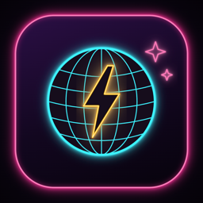
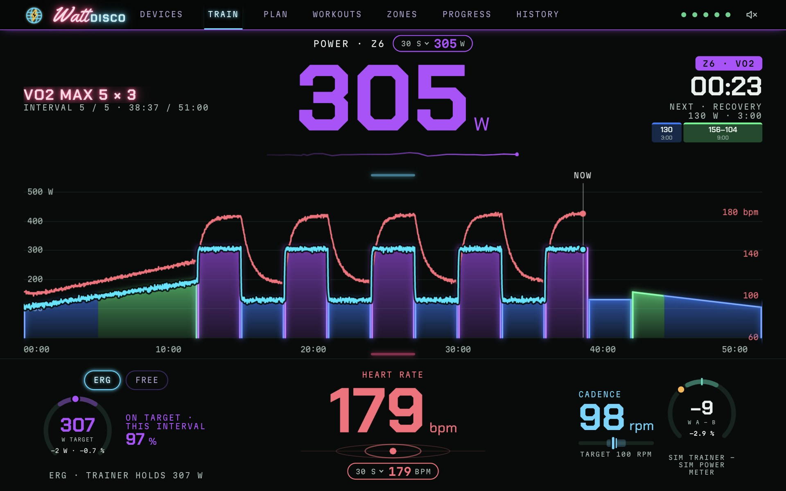
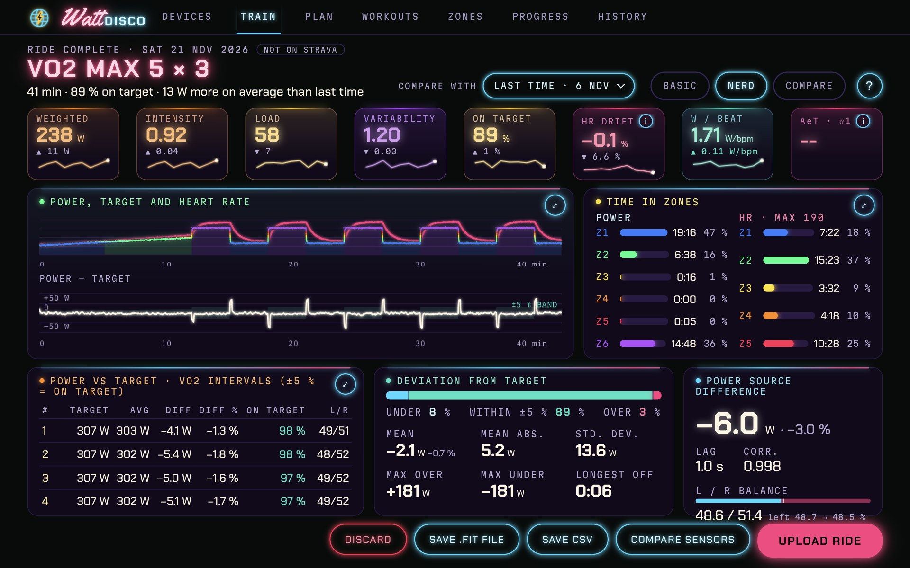
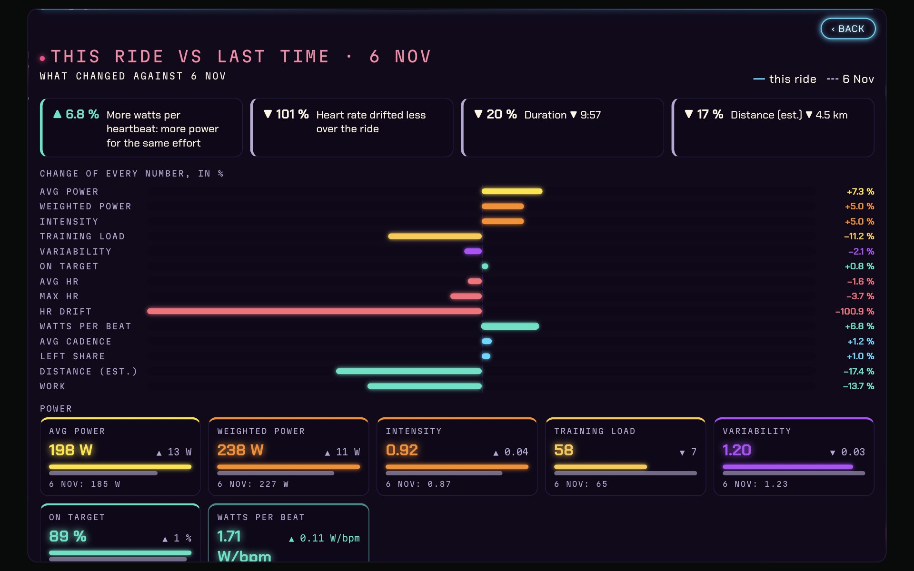
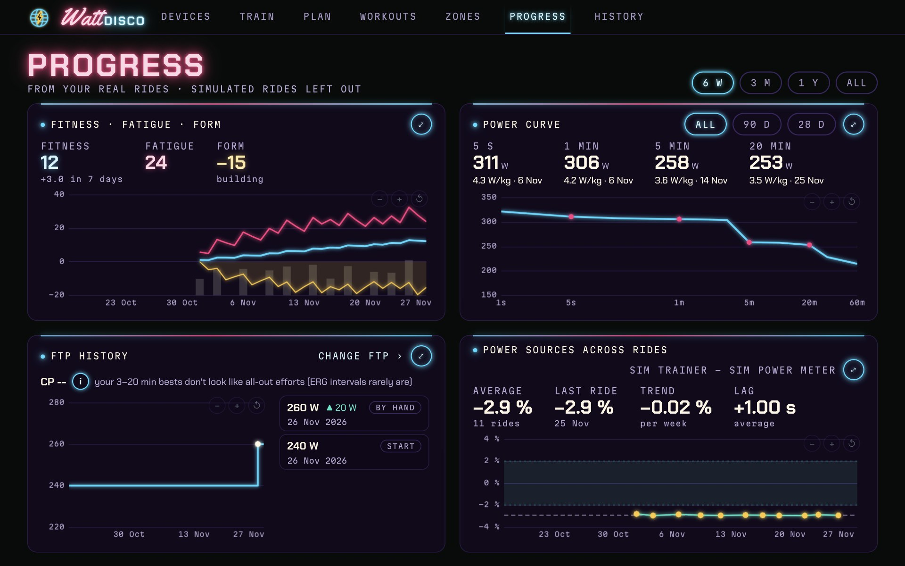
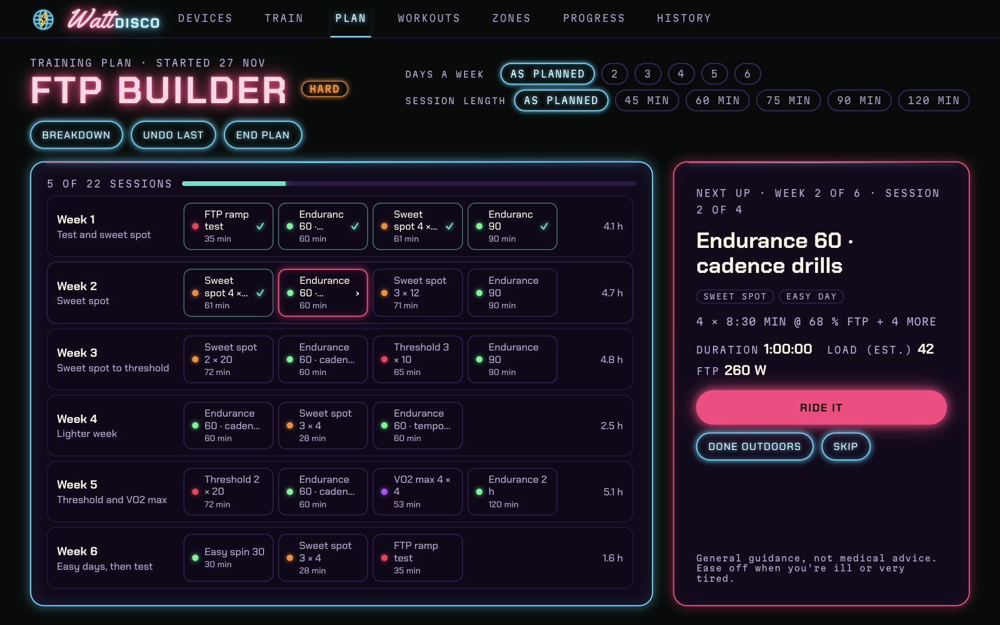
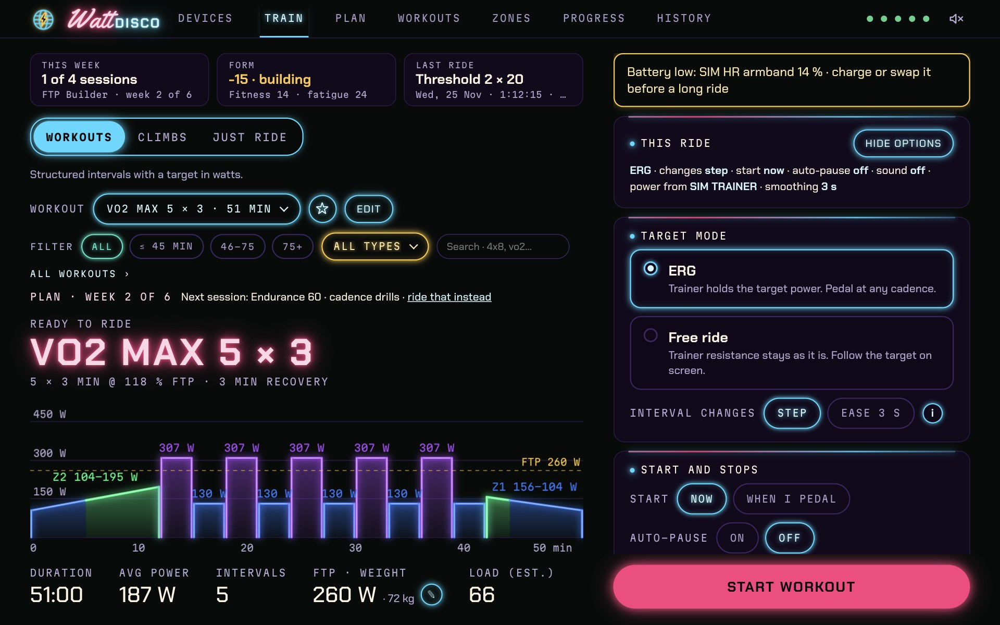

<p align="center">
  
</p>

<h1 align="center">Watt Disco</h1>

<p align="center">
  <b>Indoor cycling training, built with AI, by cyclists for cyclists.</b><br>
  Your smart trainer, power meter and heart rate strap over Bluetooth. Structured workouts in ERG or free ride.<br>
  Every sensor recorded, every ride on your own computer.
</p>

<p align="center">
  <a href="https://github.com/hunorkertesz/wattdisco/releases/latest/download/WattDisco-mac.dmg"><b>Download for Mac</b></a>
  &nbsp;·&nbsp;
  <a href="https://github.com/hunorkertesz/wattdisco/releases/latest/download/WattDisco-windows.exe"><b>Download for Windows</b></a>
  <br>
  <sub>Free for noncommercial use · no account · no ads · <a href="#install">how to install</a></sub>
</p>

<p align="center">
  
</p>
<p align="center"><sub>Nerd mode, in the middle of a VO2 max workout (all pictures show simulated rides)</sub></p>

<p align="center">
  <a href="#nerd-mode">Nerd mode</a> ·
  <a href="#features">Features</a> ·
  <a href="#install">Install</a> ·
  <a href="#while-riding">Keys</a> ·
  <a href="#strava">Strava</a> ·
  <a href="#your-data">Your data and privacy</a> ·
  <a href="#development">Development</a>
</p>

---

## Nerd mode

The standard view stays calm: power, heart rate, cadence, target. Press **N** and the same screen answers the questions
you have in the middle of an interval.

**While you ride**

| You see | It tells you |
|---|---|
| **Target ring** | A dot moves round as your power goes under or over the target; the ±5 % band is marked. Below it, the difference in watts and percent. |
| **On target** | The share of this interval within ±5 % of the target, so far. |
| **Recent averages** | Power and heart rate over the last 30 s, 1, 5 or 10 min, next to the live numbers. |
| **Power source ring** | How far your trainer and your power meter are apart right now, with a ±2 % band. |
| **Cadence target** | A line that moves as you pedal slower or faster than the interval asks for. |
| **This interval ±5 W** | Make only the current interval harder or easier (**↑ ↓**), or skip to the next one (**S**). |

**After the ride**

<p align="center">
  
</p>
<p align="center"><sub>The nerd view of a ride summary: one screen, no scrolling</sub></p>

- **Eight tiles with their trend:** weighted power, intensity, training load, variability, time on target, heart rate
  drift, watts per heartbeat and an aerobic threshold estimate, each with its change against a ride you choose.
- **Power minus target** under the ride chart, so you see where you drifted off.
- **Every interval:** target, average, difference, time on target and left/right balance.
- **Deviation from target:** share under, within and over ±5 %, mean, spread, and the longest stretch off target.
- **Two power sources:** their mean difference, lag and correlation over the ride.
- **Aerobic threshold (DFA α1):** estimated from the beat-to-beat intervals of your strap, when the ride allows it, with a
  plot that explains it. A training estimate, not a medical reading.

Not sure what a number means? **?** explains them all.

## A closer look

| | |
|---|---|
| <br>**Compare** a ride with the last time you rode the same workout: what changed most, at a glance | <br>**Progress:** fitness, power curve, FTP and power sources over time; every chart zooms |
| <br>**Training plans** that fit your days and hours | <br>**Ready to ride:** find a workout, see your options in one line, start on your first pedal stroke |

## Features

**Ride**
- **ERG and free ride.** The trainer holds the target (FTMS), or you ride a flat road and follow it. Interval changes as a
  step or eased in over 3 s; ERG lets go when cadence drops below 50 rpm, so the cranks never lock.
- **A clean riding view.** Power is the main number, coloured by the zone you are in; heart rate pulses with your beats;
  cadence draws one wave per pedal stroke. Controls only show while you reach for them. Nerd mode, big numbers and a
  live sensor comparison are one key away.
- **Made for the bike.** A 3-2-1 count-in, beeps in the last seconds of each interval, auto-pause when you stop
  pedalling (or start the workout on your first pedal strokes), the screen stays awake, and larger numbers if the
  screen is further away. The next intervals show as coloured blocks, a warning makes its number pulse, and End ride is
  held for a second so a brush against the screen never ends it. A ride cut short by a crash or a power cut can be
  continued where it stopped.
- **Every sensor, recorded.** Trainer and power meter, two heart rate straps, left/right balance, RR intervals and
  battery levels, even the ones that aren't the main source.
- **Just ride.** No workout and no target: the trainer rides like a flat road, you shift gears, and the ride is
  recorded until you end it.
- **Trainer calibration.** A spin-down over Bluetooth, step by step, for trainers that offer it.

**Train**
- **Workouts.** 40+ built-ins by type (endurance, tempo, sweet spot, threshold, VO2 max, sprints, strength, FTP tests),
  your own in the editor, or imported from `.zwo`, `.erg` and `.mrc` files. Star your favourites, filter by type and
  length, search ("4x8", "vo2"), or browse them all as cards. FTP and weight change right on the ready screen.
- **Training plans.** 13 multi-week plans in four groups: getting started, raising your FTP, top-end power, and
  climbing and long days. From First steps (easy) to Threshold and VO2 max (very hard), tailored to how many days a week
  you ride and how long a session can be. The plan suggests the next session; ride it, skip it, or mark it done outdoors.
- **FTP tests.** Ramp test and 20 min test set your FTP; any ride with a better 20 minutes suggests a new one.

**Climb**
- **Climbs.** The road's gradient sets the trainer's resistance, as on a real climb (FTMS simulation); your power and
  weight move you up it. Built-in climbs, or your own from a `.gpx` file (only the distance and gradients are kept,
  never the GPS positions). Difficulty 25–100 %.
- **Ride against your best.** A ghost of your fastest earlier ride up the same climb, and how many seconds ahead or
  behind you are. Live speed, VAM, W/kg and time to the top in nerd mode.
- **Climb summary.** Time to the top, VAM, W/kg, your best times up each climb, and power by gradient.

**Analyse**
- **Ride summary** in three views: the basics, a nerd dashboard, and a side-by-side **compare** with the last time you
  rode the same workout (or any earlier ride, or your 28-day average). A one-line verdict on top, any panel full
  window with more detail, and every second's numbers where you point on the chart.
- **Progress.** Fitness, fatigue and form, your power curve, FTP history, critical power and W′, how your two power
  sources drift apart over weeks, and your best time up each climb. Every chart zooms and shows each point.
- **Aerobic threshold from heart rate variability** (DFA α1), from the strap's RR intervals.
- **History** of every ride, by week, with totals for 7 days, 28 days or all time, how each ride felt (1–10) and your
  notes; filter by type or search. A deleted ride can be brought back.
- **Exports:** `.fit` (with an estimated speed and distance, so Strava draws the ride) and a per-second CSV with every sensor
  in its own columns.

## Install

Every version is on the [Releases](../../releases) page:

| System | File | First start |
|---|---|---|
| macOS 12 or newer, Apple silicon (M1 or later) | [`WattDisco-mac.dmg`](https://github.com/hunorkertesz/wattdisco/releases/latest/download/WattDisco-mac.dmg) | Drag Watt Disco to Applications. The app is not signed yet: System Settings → Privacy & Security → **Open Anyway**, then allow Bluetooth. |
| Windows, 64-bit | [`WattDisco-windows.exe`](https://github.com/hunorkertesz/wattdisco/releases/latest/download/WattDisco-windows.exe) | SmartScreen: **More info** → **Run anyway**. |

Watt Disco opens in its own window, asks for your FTP, weight and max heart rate (or lines up a ramp test), finds
your sensors and reconnects the ones you used last time. Metric or imperial units.

> **Hardware.** Any smart trainer with Bluetooth FTMS (for ERG), Bluetooth power meters and heart rate straps.
> A KICKR accepts only a few Bluetooth connections at once: connect the power meter and the strap first.

## Run from source

Needs Python 3.12 and [uv](https://docs.astral.sh/uv/).

```bash
uv sync
uv run wattdisco          # the app in its own window, real sensors
uv run wattdisco --sim    # simulated trainer, power meter and heart rate straps: no hardware needed
```

<details>
<summary>All commands</summary>

```bash
uv run wattdisco --fullscreen      # full screen, for the bike display
uv run wattdisco serve --sim       # in a browser instead of a window: http://localhost:8000
uv run wattdisco serve --sim --speed 10   # the simulated ride runs 10x faster
uv run wattdisco serve             # browser, real sensors
uv run wattdisco scan              # find sensors, connect, print live power, cadence and heart rate
uv run wattdisco scan --list-only  # only list what is advertising
uv run wattdisco scan --sim        # a fake ride in the terminal
uv run wattdisco --help
```

macOS: the terminal you run this from needs Bluetooth permission (System Settings → Privacy & Security →
Bluetooth). Without it macOS stops the process as soon as scanning starts (exit code 134, no message).
</details>

### While riding

Move the mouse or tap the screen to show the controls; they fade away again on their own.

| Key | Action | Key | Action |
|---|---|---|---|
| Space | pause / resume | + / − | zoom the chart |
| N | nerd mode | F | the whole workout in the chart |
| B | big numbers | ↑ / ↓ | this interval ±5 W (nerd mode) |
| C | sensor comparison | S | skip to the next phase (nerd mode) |
| M | mute / unmute the sound cues (or the speaker, top right) | G | the ghost on a climb, on or off |

## Strava

Press **Upload ride** after a ride, **Connect with Strava** once, and switch on automatic upload if you like. New uploads are
visible to "only you" until you change it. Simulated rides are never uploaded on their own.

The sign-in goes through a small relay (`relay/`, a Cloudflare Worker) that keeps the shared app's secret and never sees
your rides; the rides go straight to Strava. Strava lets a new app connect only a limited number of riders until it
approves more. If the app says the connection is full, save the ride's `.fit` file from its summary and upload it at
`strava.com/upload`: it holds power, heart rate, cadence and the estimated speed and distance.

The app can also use your own Strava API app:

<details>
<summary>Your own Strava API app</summary>

1. Create an API application at <https://www.strava.com/settings/api> and set **Authorization Callback Domain** to
   `localhost`.
2. Copy `.env.example` to `.env` and fill in `STRAVA_CLIENT_ID` and `STRAVA_CLIENT_SECRET`. Running an installed app?
   Put `.env` in the data folder (see [Your data](#your-data)).
3. Restart Watt Disco, finish a ride, press **Upload ride** and **Connect with Strava**. The sign-in is kept in
   `strava_tokens.json` in the data folder (readable only by you) and refreshed automatically.

Your own keys always win over the shared app. `relay/README.md` explains how to set up the relay.
</details>

## Your data

Everything stays on your computer, in your own app folder:

| System | Folder |
|---|---|
| macOS | `~/Library/Application Support/Watt Disco` |
| Windows | `%LOCALAPPDATA%\Watt Disco` |
| Linux | `~/.local/share/Watt Disco` |

Rides (`rides/`, one `.jsonl` per ride with every sample), workouts and climbs, settings, the training plan, FTP
history, the Strava sign-in and a log of what the app did (`logs/`). Set `WATTDISCO_DATA` to use another folder.
Something not working? **Copy diagnostics** on the Devices screen shows the app's versions, your devices and the end of
the log, to paste into an [issue](https://github.com/hunorkertesz/wattdisco/issues).

### Privacy

No account, no analytics, no ads, no crash reports, no update checks: nothing leaves your computer until you
connect Strava. Then the app uploads the rides you choose straight to Strava, and only the sign-in goes through
the Watt Disco relay, which stores and logs nothing. Heart rate and the rest of your rides stay local unless you
upload them. Delete the folder above and everything is gone. The details, including the relay and Cloudflare,
are in [`PRIVACY.md`](PRIVACY.md).

## Development

```bash
uv run pytest                      # the tests; everything runs on simulated sensors
```

- [`CLAUDE.md`](CLAUDE.md): what each screen does and the rules the app follows.
- [`ARCHITECTURE.md`](ARCHITECTURE.md): how the code is laid out, the API and the data formats.
- The UI is plain HTML, CSS and JavaScript in `src/wattdisco/web/`, served by FastAPI and shown in a pywebview window.
  All Bluetooth goes through Python (`bleak`).

<details>
<summary>Build the apps</summary>

Every version tag builds both apps on GitHub (`.github/workflows/release.yml`): tests, then `WattDisco-mac.dmg` and
`WattDisco-windows.exe`, attached to a draft release.

```bash
git tag v1.0.0 && git push origin v1.0.0   # the tag must match __version__ in src/wattdisco/__init__.py
```

On your own computer:

```bash
uv sync --group build
uv run pyinstaller packaging/wattdisco.spec --noconfirm   # dist/Watt Disco.app or dist/WattDisco.exe
packaging/make_dmg.sh "dist/Watt Disco.app" WattDisco-mac.dmg   # macOS only
```

Started without a terminal, the app writes its output to `wattdisco.log` in the data folder. Every licence text goes
into the app's `licenses/` folder.
</details>

<details>
<summary>Hardware checklist (before a release)</summary>

- [ ] `wattdisco scan` lists the trainer, power meter and heart rate strap with the right roles
- [ ] Live power, cadence and heart rate once per second, plausible values
- [ ] Stop pedalling: cadence drops to 0 within about 2 s
- [ ] Take off the strap or switch off a sensor: "no data" after 5 s, reconnects when back
- [ ] ERG: "ERG · TRAINER HOLDS … W", and the trainer follows each new target within a few seconds
- [ ] Free ride: resistance drops to a flat-road feel; switching back to ERG takes control again
- [ ] Turn the trainer off and on mid-ride: it reconnects and gets the current ERG target back
- [ ] Devices: rescan finds everything; connect and disconnect per device; roles stick after a restart
- [ ] Power meter zero offset (unclipped, cranks still): the meter answers with an offset
- [ ] Battery levels show for the power meter and the strap; left/right balance shows after a ride
- [ ] Sensor comparison with trainer, power meter and two straps: sensible difference, lag under 2 s, CSV opens
- [ ] Restart the app: the last devices reconnect on their own, missing ones are named
</details>

## Disclaimer

Watt Disco is not a medical device; ride at your own risk. ERG mode controls your trainer's resistance. Training plans
and estimates (critical power, aerobic threshold) are general guidance, not medical advice.

Not affiliated with or endorsed by Strava, Garmin, Wahoo, TrainingPeaks, Zwift, TrainerRoad or Golden Cheetah. Their
names, and product names such as KICKR, are trademarks of their owners, used here only to name the file formats,
services and hardware that Watt Disco works with. Every other product or company name in this repository, such as
Apple, macOS, Windows, Bluetooth and ANT+, also belongs to its owner.

## Licence

Free for noncommercial use, source available: [PolyForm Noncommercial 1.0.0](LICENSE). You may use, change and share
Watt Disco for yourself, a club, a school or a charity, but not sell it or use it commercially (for example in paid
coaching or a gym) without permission. Whoever gets a copy from you must get the `LICENSE` too.

The bundled fonts and the Python packages keep their own licences, listed in
[`THIRD_PARTY_NOTICES.md`](THIRD_PARTY_NOTICES.md); include both files when you share a packaged download.
